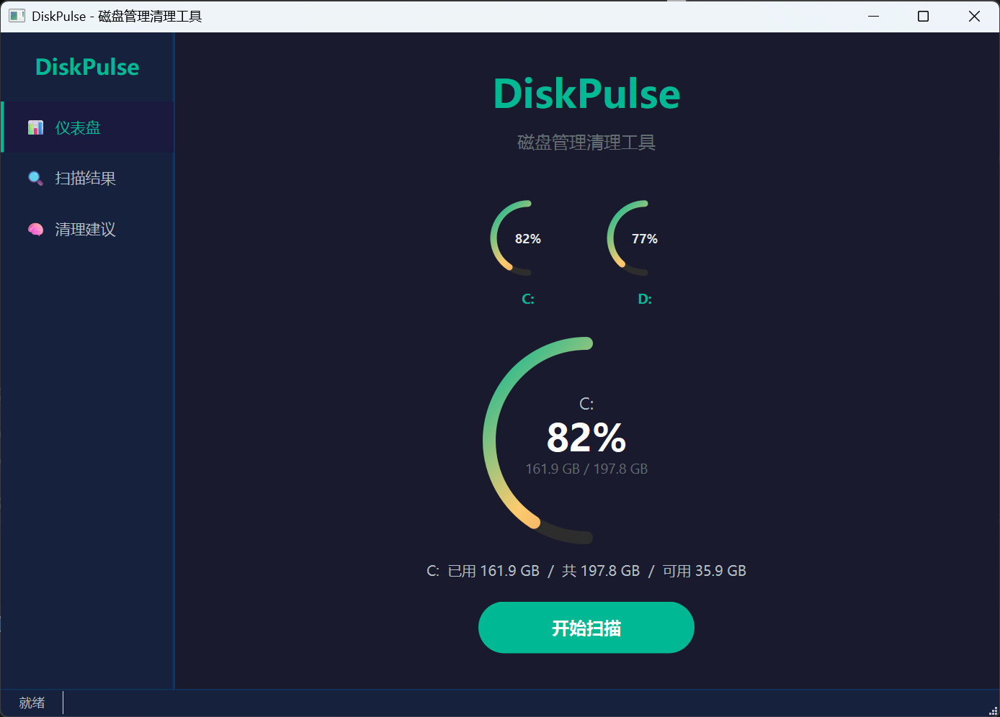
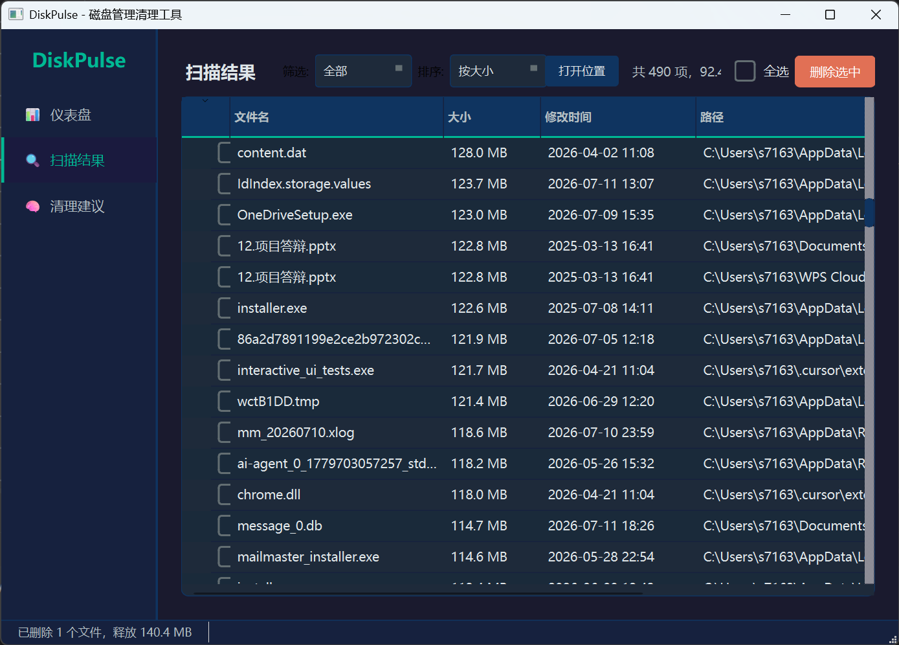
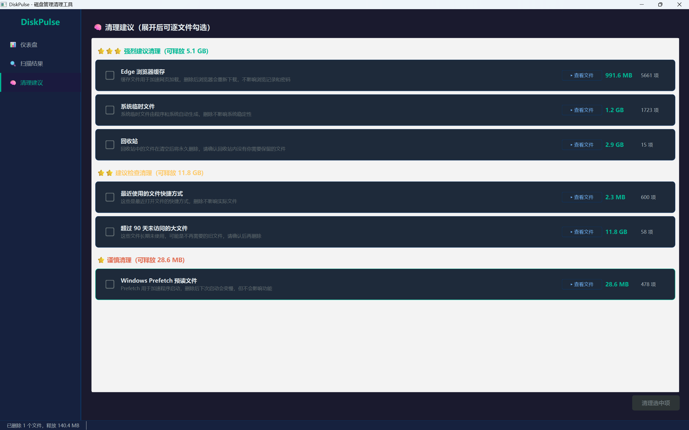

# DiskPulse - 磁盘管理清理工具 / Disk Management & Cleanup Tool


---

## 📋 项目简介 / Overview

**DiskPulse** 是一个基于 Python + PySide6 开发的现代化磁盘空间分析与清理工具，支持多维度扫描、智能清理建议、可视化仪表盘。

**DiskPulse** is a modern disk space analysis and cleanup tool built with Python + PySide6, featuring multi-dimensional scanning, intelligent cleanup suggestions, and a visual dashboard.

---

## ✨ 核心功能 / Key Features

### 📊 可视化仪表盘 / Visual Dashboard
- 实时显示所有磁盘分区使用率（环形进度条） / Real-time disk partition usage (circular progress bars)
- 点击切换监控磁盘，查看已用/可用/总容量 / Click to switch disks, view used/free/total capacity
- 一键启动扫描 / One-click scan

### 🔍 多维度扫描 / Multi-dimensional Scanning
| 扫描类型 / Scan Type | 说明 / Description |
|---------------------|-------------------|
| **大文件** / Large Files | 超过阈值（默认 100MB）的文件 / Files exceeding threshold (default 100MB) |
| **临时文件** / Temp Files | 系统/用户临时目录下的缓存文件 / Cache files in system/user temp directories |
| **旧文件** / Old Files | 超过指定天数（默认 90天）未访问的文件 / Files not accessed for specified days (default 90) |
| **空文件夹** / Empty Folders | 递归查找空目录 / Recursively find empty directories |
| **缓存文件** / Cache Files | 浏览器、IDE、系统缓存目录 / Browser, IDE, system cache directories |
| **重复文件** / Duplicate Files | 基于内容哈希（MD5/SHA256）去重 / Content-based hash deduplication (MD5/SHA256) |

### 🧠 智能清理建议 / Smart Cleanup Suggestions
- **三级风险分级** / Three-level risk classification:
  - ⭐⭐⭐ 强烈建议清理 / Strongly Recommended (Temp, cache, recycle bin)
  - ⭐⭐ 建议检查清理 / Recommended (Duplicates, large old files)
  - ⭐ 谨慎清理 / Caution (System-related, possibly locked files)
- **逐文件勾选** / Per-file selection: 展开建议卡片，逐个文件确认勾选，避免误删
- **主复选框三态联动** / Tri-state master checkbox: 全不选/半选/全选自动同步 / Auto-sync unchecked/partial/checked

### 📁 扫描结果交互 / Scan Results Interaction
- **多列排序** / Multi-column sort: 按大小、名称、修改时间、类别排序
- **类别筛选** / Category filter: 下拉框快速筛选单一类别
- **多标签显示** / Multi-tag display: 同一文件属于多类别时（如“大文件 + 旧文件”），类别列显示多个彩色标签
- **去重合并** / Deduplication: 同路径文件自动合并类别而非重复列出
- **右键菜单** / Context menu: 打开文件位置 / 复制路径
- **双击/按钮打开** / Double-click/Open button: 直接在资源管理器中定位文件

### 🎨 响应式界面 / Responsive UI
- **QSplitter 侧边栏** / QSplitter sidebar: 可拖拽调整宽度（160~300px）
- **自适应仪表盘** / Adaptive dashboard: 驱动器卡片网格随窗口自动换行
- **深色主题** / Dark theme: 护眼配色，支持高分屏

### 🌐 多语言支持 / Multi-language Support
- **中文 (简体)** / Chinese (Simplified)
- **English** / English
- 侧边栏语言切换器，重启后完全生效 / Sidebar language switcher, effective after restart

---

## 🚀 快速开始 / Quick Start

### 环境要求 / Requirements
- Windows 10/11
- Python 3.11+
- 推荐使用 Miniconda / Anaconda

### 安装依赖 / Install Dependencies
```bash
# 克隆项目 / Clone repository
git clone https://github.com/yourname/DiskPulse.git
cd DiskPulse

# 创建虚拟环境 / Create virtual environment (optional)
conda create -n diskpulse python=3.11
conda activate diskpulse

# 安装依赖 / Install dependencies
pip install -r requirements.txt
```

### 运行 / Run
```bash
python main.py
```

> 首次运行会请求管理员权限，建议允许以扫描系统目录（如 `C:\Windows`、`Program Files`）。
> First run requests admin privileges; allow to scan system directories (e.g., `C:\Windows`, `Program Files`).

---

## 📦 依赖包 / Dependencies

```
PySide6>=6.6
psutil>=5.9
pyyaml>=6.0
send2trash>=1.8
```

---

## ⚙️ 配置文件 / Configuration

### `settings.json` - 用户设置 / User Settings
```json
{
  "scan_paths": ["C:/", "D:/"],
  "min_large_file_mb": 100,
  "old_file_days": 90,
  "enable_duplicate_scan": true,
  "hash_algorithm": "md5",
  "language": "zh_CN",
  "use_recycle_bin": true,
  "confirm_before_delete": true
}
```

### `rules.yaml` - 清理规则 / Cleanup Rules
```yaml
rules:
  - name: "windows_temp"
    description: "Windows 临时文件"
    importance: 3
    importance_label: "强烈建议清理"
    hint: "系统临时文件，通常可安全删除"
    paths:
      - "%TEMP%"
      - "%WINDIR%\\Temp"
    max_age_days: 7
```

---

## 🏗️ 项目结构 / Project Structure

```
DiskPulse/
├── main.py                 # 入口 / Entry
├── requirements.txt        # 依赖列表 / Dependencies
├── rules.yaml              # 清理规则配置 / Cleanup rules
├── settings.json           # 用户设置 / User settings
├── app/
│   ├── __init__.py         # 应用工厂 / App factory
│   ├── main_window.py      # 主窗口 / Main window (QSplitter + StackedWidget)
│   ├── i18n.py             # 翻译管理 / Translation manager
│   ├── models/             # 数据模型 / Data models
│   │   ├── file_item.py    # FileItem(多类别支持)
│   │   ├── scan_result.py  # ScanResult 聚合
│   │   ├── advisor_item.py # AdvisorItem(建议卡片)
│   │   └── settings.py     # 配置持久化 / Settings persistence
│   ├── scanner/            # 扫描引擎 / Scanner engine
│   │   ├── engine.py       # ScanEngine(QThread)
│   │   ├── cache_detector.py
│   │   ├── duplicate_finder.py
│   │   └── recycler.py
│   ├── advisor/            # 智能建议引擎 / Advisor engine
│   │   ├── engine.py       # AdvisorEngine(规则+启发式)
│   │   └── actions.py      # AdvisorActions(执行清理)
│   ├── ui/                 # 界面组件 / UI components
│   │   ├── dashboard.py    # 仪表盘(环形图+网格)
│   │   ├── file_list.py    # 结果列表(排序/筛选/多标签/去重)
│   │   └── advisor_panel.py# 建议面板(逐文件勾选/三态联动)
│   ├── utils/              # 工具函数 / Utilities
│   │   ├── file_ops.py     # 删除/回收站/管理员检测
│   │   └── logger.py       # 操作日志
│   └── resources/
│       └── styles.qss      # 全局 QSS 样式
```

---

## 🔧 关键技术点 / Technical Highlights

| 模块 / Module | 技术方案 / Solution |
|--------------|-------------------|
| 扫描线程 / Scan Thread | `QThread` + 信号槽进度回调，避免阻塞 UI |
| 重复文件 / Duplicate Files | 分级哈希：先比大小 → 再算 MD5 → 可选 SHA256 |
| 回收站删除 / Recycle Bin | `send2trash` 跨平台，支持撤销 |
| 管理员提权 / Admin Elevation | `ShellExecuteW(runas)` 重启进程 |
| 多类别去重 / Multi-category Dedupe | `path -> QTreeWidgetItem` 映射，合并 `categories` 列表 |
| 自定义委托 / Custom Delegate | `QStyledItemDelegate.paint()` 绘制多标签 |
| 响应式布局 / Responsive Layout | `QSplitter` + `QGridLayout` + `setSizePolicy` |
| 翻译系统 / Translation | `QTranslator` + `.ts/.qm` + 运行时切换 |

---

## 🖼️ 界面预览 / Screenshots

> 截图占位：请替换为实际运行截图 / Replace with actual screenshots

| 仪表盘 / Dashboard | 扫描结果 / Scan Results | 清理建议 / Cleanup Suggestions |
|-------------------|------------------------|-------------------------------|
|  |  |  |

---

## 📝 更新日志 / Changelog

### v1.1.0 (2026-07-14)
- ✅ 清理建议支持逐文件勾选，主复选框三态联动
- ✅ 扫描结果：点击行切换勾选、全选修复、多类别标签、去重合并
- ✅ 数据模型支持多类别 `categories: List[FileCategory]`
- ✅ 响应式布局：QSplitter 侧边栏、自适应仪表盘网格
- ✅ 样式修复：QTreeWidget 复选框指示器可见
- ✅ **多语言支持：中英双语，侧边栏语言切换器**
- ✅ 样式修复：QTreeWidget 复选框指示器可见

### v1.0.0 (2026-07-14)
- 🎉 首个正式版：仪表盘、多维扫描、智能建议、基础清理

---

## 🤝 贡献指南 / Contributing

1. Fork 本仓库 / Fork this repo
2. 创建特性分支 / Create feature branch: `git checkout -b feat/your-feature`
3. 提交更改 / Commit changes: `git commit -m "feat: add your feature"`
4. 推送分支 / Push branch: `git push origin feat/your-feature`
5. 发起 Pull Request

---

## 📄 许可证 / License

本项目基于 [MIT License](LICENSE) 开源。

---

## ⚠️ 免责声明 / Disclaimer

- 删除操作默认移入**回收站**，可手动恢复
- 请在清理前**确认文件列表**，避免误删重要数据
- 系统目录（如 `C:\Windows`）清理需谨慎，建议仅清理临时/缓存文件
- 作者不对因使用本工具导致的数据丢失负责

---

## 📧 联系方式 / Contact

- **Email**: s71639556@163.com
- **Issues**: [GitHub Issues](https://github.com/yourname/DiskPulse/issues)
- **Discussions**: [GitHub Discussions](https://github.com/yourname/DiskPulse/discussions)

欢迎反馈 Bug、提出功能建议或提交 PR！

---

<p align="center">Made with ❤️ for Windows Users</p>